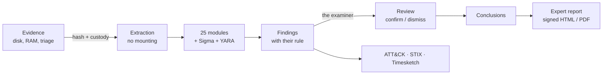

<p align="center"></p>

<p align="center">
  <a href="https://github.com/Ruby570bocadito/Sabueso-Framework/actions/workflows/tests.yml"></a>
  <a href="https://github.com/Ruby570bocadito/Sabueso-Framework/releases/latest"></a>
  <a href="LICENSE"></a>
  
  
</p>

<p align="center">
  <b>Windows forensics for expert witnesses</b>: from the disk image to the signed expert report,<br>
  with a chain of custody you can prove and a bloodhound that tells you what to do next.
  <br><br>
  <a href="#try-it-in-a-minute">Try it</a> ·
  <a href="docs/MANUAL.en.md">Manual</a> ·
  <a href="docs/VALIDACION.md">Validation</a> ·
  <a href="TODO.md">Roadmap</a> ·
  <a href="README.md">Español</a>
</p>

---

<p align="center"></p>

## What it is

**Sabueso** (Spanish for *bloodhound*) is a free tool (Apache 2.0) to investigate compromised Windows computers and
present what was found, with guarantees, to a client or a court. It opens disk images without mounting them, analyses
more than 25 kinds of artifacts, flags **leads** together with the rule that fired them and lets the examiner confirm
or dismiss each one. Everything goes into a SHA-256 chained custody log and ends in a report in English or Spanish.

> Findings ≠ conclusions. Sabueso shows where to look; **the examiner signs the verdict**.

## Why Sabueso

| | |
|---|---|
| ⚖️ **Built for expert witnesses** | Expert report (UNE 71506) with purpose, limitations derived from the case itself, the expert's declaration, proceedings on the cover and an Ed25519 signature. |
| 🔗 **Custody you can prove** | Evidence is never modified; every action, report and export goes into a hash-chained log, and extracted files keep their original timestamps. |
| 🧭 **It guides you** | Every case knows where it stands: the CLI and the web tell you the next step and the exact command. |
| 📊 **Validated on real cases** | Tested on 261 real attacks, 599 Hayabusa logs and the NIST "Hacking Case" disk; the figures, the bugs found and their fixes are [public](docs/VALIDACION.md). |
| 🧰 **All in one, no cloud** | E01, VHDX, VMDK, QCOW2, VSS and BitLocker; registry, EVTX + Sigma, $MFT, Prefetch, SRUM, recycle bin, browsers, memory with Volatility, YARA, MITRE ATT&CK, STIX 2.1 and Timesketch. Works in an air-gapped lab. |
| 🌍 **Truly bilingual** | The same case is reviewed and reported in English or Spanish. |

## Try it in a minute

```bash
sabueso demo ./lab -L en            # builds a fictitious intrusion case and analyses it
sabueso web -w ./lab --open         # opens it in the browser
```

To install it, pick one way (all of them end with `sabueso doctor`, which checks that everything works):

| Way | How |
|---|---|
| **Windows, no Python** | Download `sabueso-<version>-windows-x64.zip` from [Releases](https://github.com/Ruby570bocadito/Sabueso-Framework/releases/latest), unzip it and run `sabueso\sabueso.exe`. Fits on a USB stick. |
| **Windows installer** | `irm https://raw.githubusercontent.com/Ruby570bocadito/Sabueso-Framework/main/install/install.ps1 \| iex` |
| **Linux and macOS** | `curl -fsSL https://raw.githubusercontent.com/Ruby570bocadito/Sabueso-Framework/main/install/install.sh \| sh` |
| **Docker** | `docker compose up -d` (web at `http://127.0.0.1:8765`) |
| **pip** | `pip install https://github.com/Ruby570bocadito/Sabueso-Framework/archive/refs/heads/main.zip` |

Details and options in the [manual](docs/MANUAL.en.md#installation).

## How it works



In practice, one command does the automatic part and you do the part that is yours:

```bash
sabueso auto disk.E01 --new ./case-2026-017 -i "R. Garcia"     # extracts, analyses, reports and exports
sabueso -c ./case-2026-017 findings -L en                       # review the leads
sabueso -c ./case-2026-017 review 12 confirmed -n "Matches the DC's 4688"
sabueso -c ./case-2026-017 report --expert --court "Court of First Instance no. 3" --pdf --sign -L en
```

## At a glance

<p align="center"></p>

| Case summary, with the next step | MITRE ATT&CK techniques observed |
|---|---|
|  |  |
| **Findings and their review** | **Dark mode** (follows the system) |
|  |  |

Screenshots in Spanish; the interface switches to English with its ES/EN selector or `-L en`.

## Validated on real cases

| Public data set | Result |
|---|---|
| 261 logs of real attacks ([EVTX-ATTACK-SAMPLES](https://github.com/sbousseaden/EVTX-ATTACK-SAMPLES)) | 24 % detected with the 15 built-in rules, **74 %** with SigmaHQ's; 0 read errors |
| 599 [Hayabusa](https://github.com/Yamato-Security/hayabusa-sample-evtx) logs | 26,197 events and 2,888 findings without a single failure, in 108 s with 2,405 Sigma rules |
| [NIST "Hacking Case"](https://cfreds-archive.nist.gov/Hacking_Case.html) disk (Windows XP) | **15 of 31** official questions fully answered and 9 partly, in 13 s |

Every bug found became a regression test. Method, figures and what is missing (in Spanish):
[docs/VALIDACION.md](docs/VALIDACION.md).

## When to use another tool

Sabueso is honest about its limits (full list in the [manual](docs/MANUAL.en.md#known-limitations)):

- **Linux, macOS or mobile** as analysed systems: not yet.
- **Hundreds of machines at once**: for hunting at scale, a platform such as Velociraptor; Sabueso can analyse its
  collections afterwards.
- **In-depth memory analysis**: Sabueso automates the usual Volatility 3 plugins; for complex investigations, use
  Volatility directly.
- **Event log detection**: minimal with the built-in rules; download SigmaHQ's (`sabueso sigma download`;
  `sabueso doctor` reminds you).

## Documentation

- [Manual](docs/MANUAL.en.md): installation, configuration, every command, modules, reports, integrity and how to write
  a module.
- [Validation](docs/VALIDACION.md) (Spanish): how Sabueso is tested on real cases and with what results.
- [Identity](docs/IDENTIDAD.md) (Spanish): how Sabueso speaks and why reports never carry its personality.
- [Roadmap](TODO.md) (Spanish) and [CHANGELOG](CHANGELOG.md).

## Meet Sabu


Sabu is the project's mascot: a bloodhound with a blue collar and a shield-shaped tag (the custody) bearing a paw
print (the trail). It welcomes you in the terminal, keeps you company in the web interface and stays out of the
reports, because a report is read in court.

## Contributing and license

Contributions are welcome: a new artifact comes with a licensed real sample, English and Spanish texts and tests
(details in the [manual](docs/MANUAL.en.md#architecture-and-writing-a-module)). To check a change:
`python -m pytest -q` and `ruff check sabueso tests scripts`.

[Apache License 2.0](LICENSE). Dependencies keep their own licenses (details in the
[manual](docs/MANUAL.en.md#license)).
