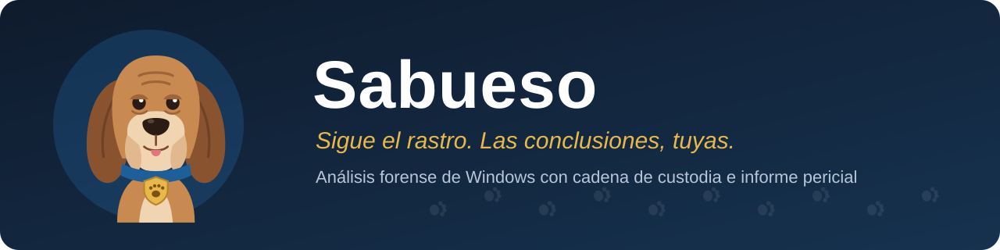
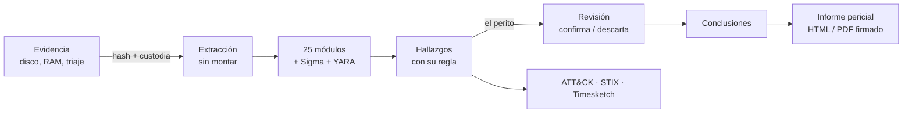
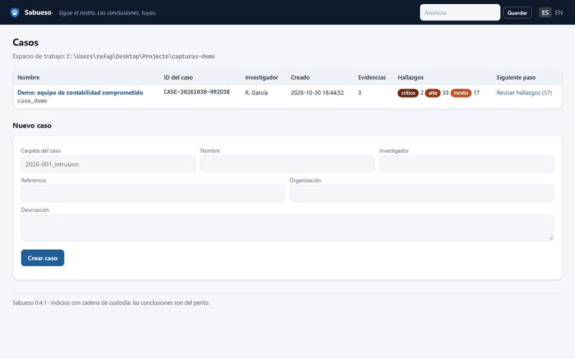
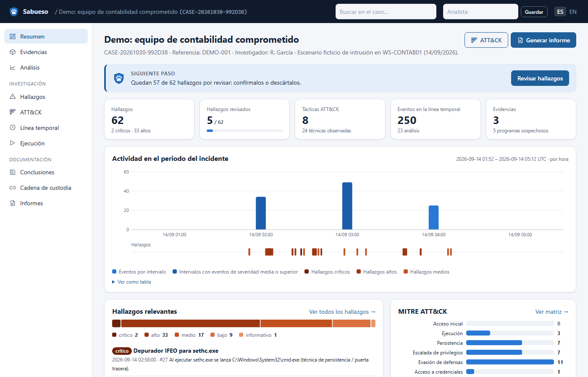
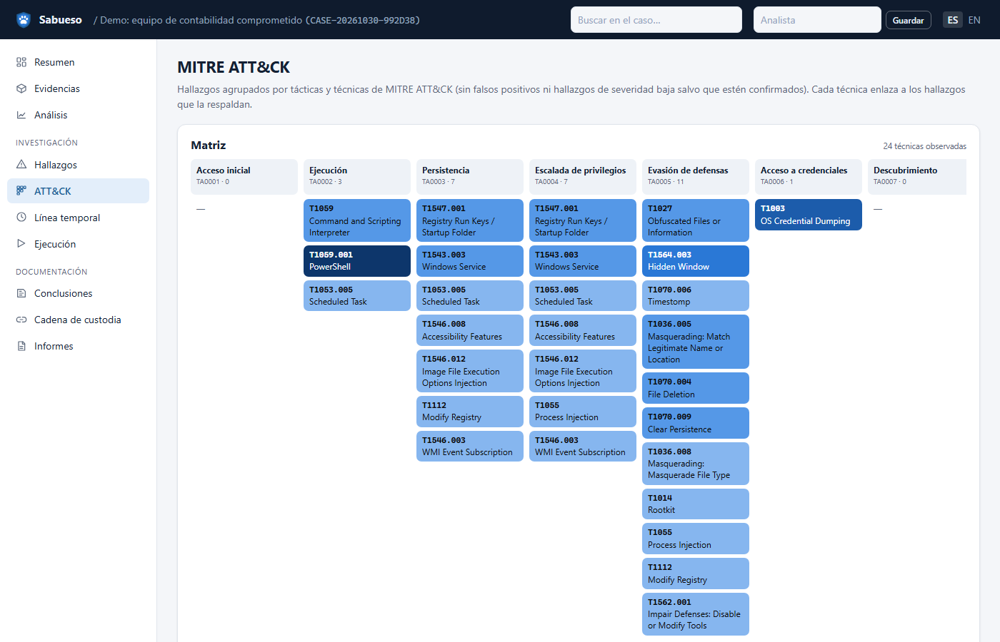
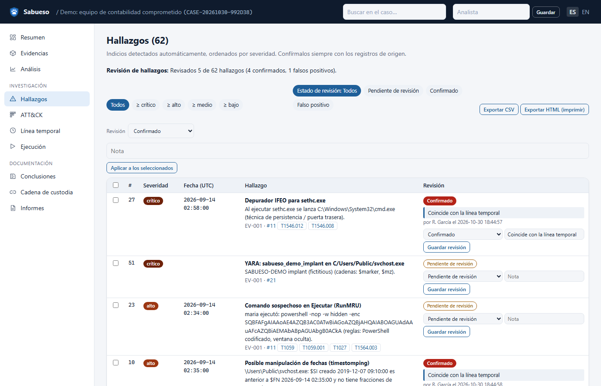
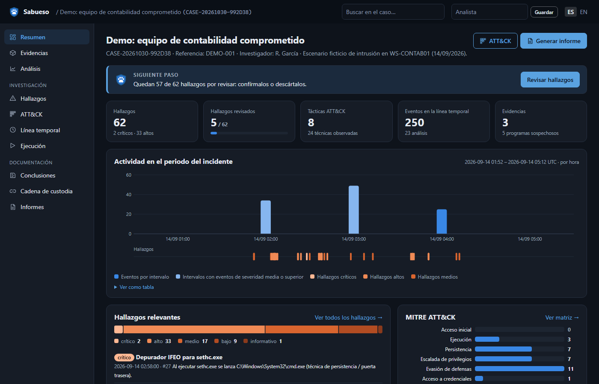

<p align="center"></p>

<p align="center">
  <a href="https://github.com/Ruby570bocadito/Sabueso-Framework/actions/workflows/tests.yml"></a>
  <a href="https://github.com/Ruby570bocadito/Sabueso-Framework/releases/latest"></a>
  <a href="LICENSE"></a>
  
  
</p>

<p align="center">
  <b>Análisis forense de Windows para peritos</b>: de la imagen de disco al informe pericial firmado,<br>
  con una cadena de custodia que se puede demostrar y un sabueso que te dice qué hacer después.
  <br><br>
  <a href="#pruébalo-en-un-minuto">Pruébalo</a> ·
  <a href="docs/MANUAL.md">Manual</a> ·
  <a href="docs/VALIDACION.md">Validación</a> ·
  <a href="TODO.md">Hoja de ruta</a> ·
  <a href="README.en.md">English</a>
</p>

---

<p align="center"></p>

## Qué es

**Sabueso** es una herramienta libre (Apache 2.0) para investigar ordenadores Windows comprometidos y presentar lo
encontrado con garantías ante un cliente o un juzgado. Abre imágenes de disco sin montarlas, analiza más de 25 tipos
de artefactos, señala **indicios** con la regla que los disparó y deja que el perito los confirme o descarte. Todo
queda en una cadena de custodia encadenada por SHA-256 y termina en un informe en español o inglés.

> Hallazgos ≠ conclusiones. Sabueso marca dónde mirar; **el veredicto lo firma el perito**.

## Por qué Sabueso

| | |
|---|---|
| ⚖️ **Pensado para el perito** | Informe pericial (UNE 71506) con objeto, limitaciones generadas a partir del caso, declaración del art. 335.2 LEC, datos del procedimiento en la portada y firma Ed25519. |
| 🔗 **Custodia demostrable** | La evidencia nunca se modifica; cada acción, informe y exportación queda en un registro encadenado por hash, y los archivos extraídos conservan sus fechas originales. |
| 🧭 **Te guía** | Cada caso sabe en qué punto está: la CLI y la web te dicen el siguiente paso y la orden exacta. |
| 📊 **Validado con casos reales** | Probado con 261 ataques reales, 599 registros de Hayabusa y el disco del NIST «Hacking Case»; las cifras, los fallos y sus correcciones son [públicos](docs/VALIDACION.md). |
| 🧰 **Todo en uno y sin nube** | E01, VHDX, VMDK, QCOW2, VSS y BitLocker; registro, EVTX + Sigma, $MFT, Prefetch, SRUM, papelera, navegadores, memoria con Volatility, YARA, MITRE ATT&CK, STIX 2.1 y Timesketch. Funciona en un laboratorio aislado. |
| 🌍 **Bilingüe de verdad** | El mismo caso se revisa e informa en español o en inglés. |

## Pruébalo en un minuto

```bash
sabueso demo ./laboratorio            # crea un caso de intrusión ficticio y lo analiza
sabueso web -w ./laboratorio --abrir  # ábrelo en el navegador
```

Para instalarlo, elige una vía (todas terminan con `sabueso doctor`, que comprueba que todo funciona):

| Vía | Cómo |
|---|---|
| **Windows, sin Python** | Descarga `sabueso-<versión>-windows-x64.zip` de [Releases](https://github.com/Ruby570bocadito/Sabueso-Framework/releases/latest), descomprímelo y ejecuta `sabueso\sabueso.exe`. Cabe en un USB. |
| **Instalador de Windows** | `irm https://raw.githubusercontent.com/Ruby570bocadito/Sabueso-Framework/main/install/install.ps1 \| iex` |
| **Linux y macOS** | `curl -fsSL https://raw.githubusercontent.com/Ruby570bocadito/Sabueso-Framework/main/install/install.sh \| sh` |
| **Docker** | `docker compose up -d` (web en `http://127.0.0.1:8765`) |
| **pip** | `pip install https://github.com/Ruby570bocadito/Sabueso-Framework/archive/refs/heads/main.zip` |

Detalles y opciones en el [manual](docs/MANUAL.md#instalación).

## Cómo trabaja



En la práctica, una orden hace todo el recorrido automático y tú haces la parte que es tuya:

```bash
sabueso auto disco.E01 --nuevo ./caso-2026-017 -i "R. García"   # extrae, analiza, informa y exporta
sabueso -c ./caso-2026-017 hallazgos                            # revisa los indicios
sabueso -c ./caso-2026-017 revisar 12 confirmado -n "Coincide con el 4688 del DC"
sabueso -c ./caso-2026-017 informe --pericial --juzgado "Juzgado de Instrucción n.º 3" --pdf --firmar
```

## Vistazo

<p align="center"></p>

| Resumen del caso, con el siguiente paso | Técnicas MITRE ATT&CK observadas |
|---|---|
|  |  |
| **Hallazgos con su revisión** | **Modo oscuro** (sigue al del sistema) |
|  |  |

## Validado con casos reales

| Conjunto público | Resultado |
|---|---|
| 261 registros de ataques reales ([EVTX-ATTACK-SAMPLES](https://github.com/sbousseaden/EVTX-ATTACK-SAMPLES)) | Detecta el 24 % con las 15 reglas integradas y el **74 %** con las de SigmaHQ; 0 errores de lectura |
| 599 registros de [Hayabusa](https://github.com/Yamato-Security/hayabusa-sample-evtx) | 26.197 eventos y 2.888 hallazgos sin un fallo, en 108 s con 2.405 reglas Sigma |
| Disco del [NIST «Hacking Case»](https://cfreds-archive.nist.gov/Hacking_Case.html) (Windows XP) | **15 de 31** preguntas oficiales respondidas por completo y 9 en parte, en 13 s |

Cada fallo encontrado se convirtió en un test de regresión. Método, cifras y lo que falta: [docs/VALIDACION.md](docs/VALIDACION.md).

## Cuándo usar otra herramienta

Sabueso es honesto con sus límites (lista completa en el [manual](docs/MANUAL.md#limitaciones-conocidas)):

- **Linux, macOS o móviles** como sistemas analizados: todavía no.
- **Cientos de equipos a la vez**: para caza a escala, una plataforma como Velociraptor; Sabueso puede analizar
  después sus recolecciones.
- **Memoria RAM a fondo**: Sabueso automatiza lo habitual de Volatility 3; para investigaciones complejas, úsalo
  directamente.
- **Detección en registros de eventos**: con las reglas integradas es mínima; descarga las de SigmaHQ
  (`sabueso sigma download`; `sabueso doctor` te lo recuerda).

## Documentación

- [Manual](docs/MANUAL.md): instalación, configuración, todas las órdenes, módulos, informes, integridad y cómo
  escribir un módulo.
- [Validación](docs/VALIDACION.md): cómo se prueba Sabueso con casos reales y qué resultados da.
- [Identidad](docs/IDENTIDAD.md): cómo habla Sabueso y por qué los informes no llevan su personalidad.
- [Hoja de ruta](TODO.md) y [CHANGELOG](CHANGELOG.md).

## Conoce a Sabu


Sabu es la mascota del proyecto: un sabueso con collar azul y una placa con forma de escudo (la custodia) y una huella
(el rastro). Te recibe en la terminal, te acompaña en la web y se queda fuera de los informes, porque un informe se
lee en un juzgado.

## Contribuir y licencia

Las contribuciones son bienvenidas: un artefacto nuevo llega con una muestra real con licencia, textos en español e
inglés y tests (detalles en el [manual](docs/MANUAL.md#arquitectura-y-cómo-crear-un-módulo)). Para comprobar un cambio:
`python -m pytest -q` y `ruff check sabueso tests scripts`.

[Apache License 2.0](LICENSE). Las dependencias conservan sus licencias (detalle en el
[manual](docs/MANUAL.md#licencia)).
